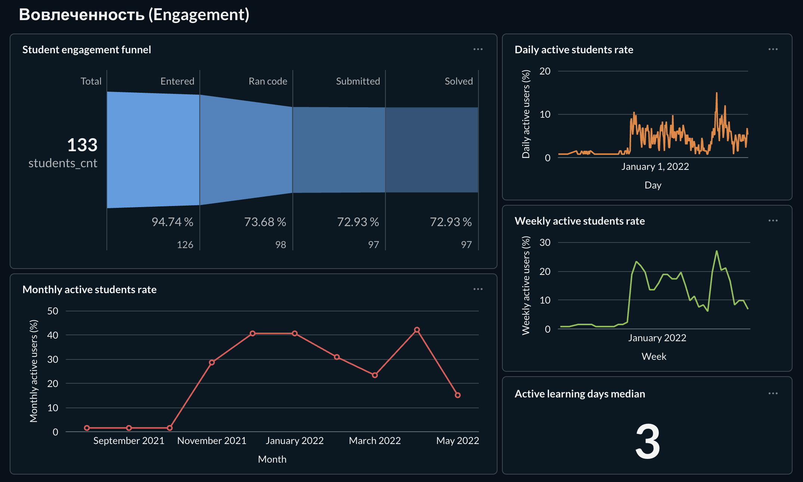
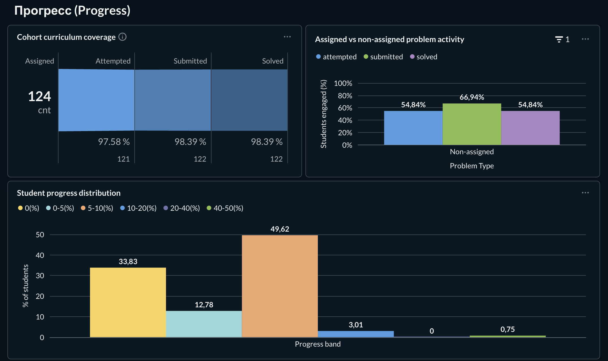
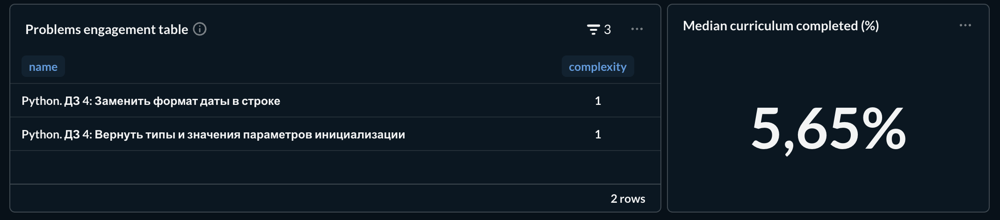
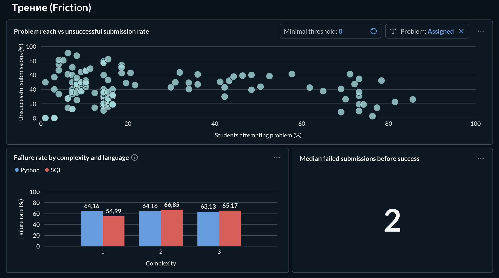
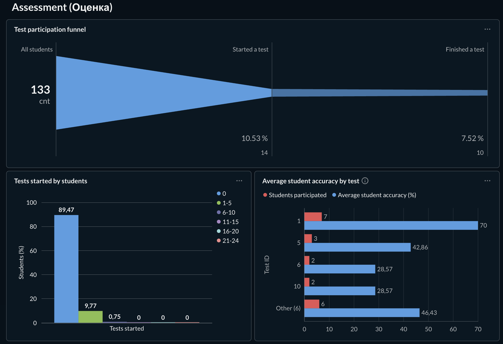
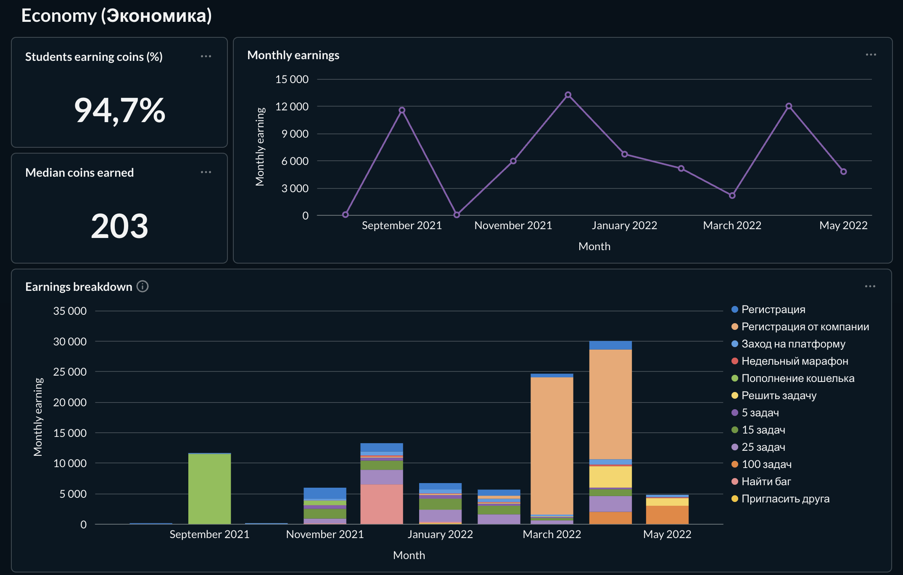
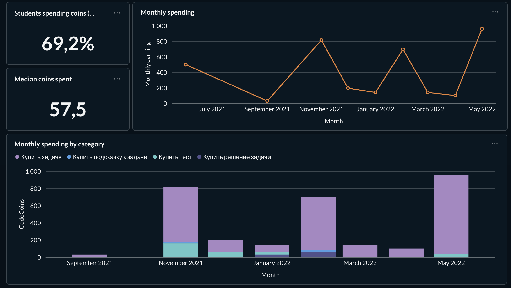

# IT Resume | Student Analytics Dashboard

**Languages:** English | [Русская версия ниже / Russian version below](#русская-версия)

An end-to-end SQL analytics project exploring student engagement, curriculum progress, problem-solving friction, assessment participation, and virtual currency usage on an educational platform.

The project combines SQL-based data analysis, interactive dashboarding in Metabase, and business-oriented interpretation of the results.

## Project Overview

The goal was to analyze the activity of students belonging to a corporate client on the IT Resume educational platform and identify patterns that could help stakeholders better understand student engagement, learning progress, and platform usage.

**Check out the full report [here](report/SQL%20Final%20Project.pdf)**

The analysis covers five areas:

- **Engagement:** How actively do students use the platform?
- **Progress:** How much of the assigned curriculum do students complete?
- **Friction:** Which problems are associated with repeated failed submissions?
- **Assessment:** How actively do students participate in tests, and what results do they achieve?
- **Economy:** How do students earn and spend virtual currency?

## Tools & Technologies

- **SQL / PostgreSQL:** Data extraction, transformation, aggregation, and analysis.
- **Metabase:** Dashboard creation and data visualization.
- **Git / GitHub:** Version control and project documentation.

## Key Findings

### 1. Engagement



- Median active learning days per student: **3 days** during the observation period.
- Approximately **26% of students** had no recorded active learning days.
- Daily, weekly, and monthly activity metrics showed different engagement patterns, suggesting that platform usage was not consistently daily.

### 2. Curriculum Progress




- **98.4% of assigned problems** were solved by at least one student in the cohort.
- Median individual curriculum completion was approximately **5.65%**, while the maximum was approximately **43.55%**.
- This contrast shows that high collective curriculum coverage did not translate into high individual completion.

### 3. Problem-Solving Friction



- The median number of failed submissions before a student's first successful solution was **2**.
- Failure rates were compared across problem difficulty levels and programming languages to explore potential differences in problem-solving friction.

### 4. Assessment



- Approximately **10.53% of students** started at least one test.
- Approximately **7.52% of students** completed at least one test.
- Test participation was low relative to the total cohort size.

### 5. Virtual Economy




- **94.7% of students** earned virtual currency.
- **69.2% of students** spent virtual currency.
- Monthly earnings and spending were analyzed alongside transaction categories to explore changes in platform activity over time.

*All findings describe the analyzed cohort and observation period. They are descriptive and should not be interpreted as proof of causation or as representative of all platform users.*

## Dashboard

The Metabase dashboard brings together multiple visualization types to support exploration of the five analytical areas.

The dashboard was designed to support reusable analysis through filters and automatic refresh.

[Click here to see full version of the dashboard in PDF](dashboard/Metabase%20-%20Final%20Project.pdf)

[Or click here if you want to visit Metabase website for an interactive version](https://metabase.simulative.ru/dashboard/661-final-project?tab=473)

## Repository Structure

```text
it-resume-student-analytics/
├── README.md
├── sql/
│   ├── 01_engagement.sql
│   ├── 02_progress.sql
│   ├── 03_friction.sql
│   ├── 04_assessment.sql
│   └── 05_economy.sql
├── dashboard/
│   └── screenshots/
└── report/
    └── analytical-report.pdf
```


## Methodology & Limitations

The analysis uses student activity records, problem-solving submissions, test participation and results, and virtual currency transactions. Metrics were selected to examine both cohort-level patterns and differences in individual student activity.

Several distinctions are important when interpreting the results:

- Cohort-level curriculum coverage measures whether a problem was solved by at least one student, not whether every student solved it.
- Individual curriculum completion measures the proportion of assigned problems solved by each student.
- Test participation is measured using recorded test starts and completed test results.
- Failed submissions before success are measured using recorded submissions, rather than elapsed wall-clock time.

The findings are limited to the available dataset, its recorded events, and the selected observation period.

---

# Русская версия

[Наверх, к английской версии / Back to English](#it-resume--student-analytics-dashboard)

Аналитический проект, посвящённый исследованию вовлечённости студентов, прогресса обучения, сложностей при решении задач, участия в тестировании и использования внутренней виртуальной валюты образовательной платформы IT Resume.

Проект объединяет анализ данных с помощью SQL, создание интерактивного дашборда в Metabase и интерпретацию результатов с точки зрения бизнес-задач.

## О проекте

Цель проекта заключалась в анализе активности студентов корпоративного заказчика на образовательной платформе IT Resume и выявлении закономерностей, которые помогают оценить вовлечённость, прогресс обучения и использование возможностей платформы.

**Полный отчет можно посмотреть [здесь](report/SQL%20Final%20Project.pdf)**

Анализ включает пять направлений:

- **Вовлечённость:** насколько активно студенты пользуются платформой?
- **Прогресс:** какую часть назначенной программы обучения осваивают студенты?
- **Сложности при решении задач:** какие задачи связаны с повторными неудачными отправками решений?
- **Оценка знаний:** насколько активно студенты участвуют в тестировании и какие результаты показывают?
- **Экономика:** как студенты зарабатывают и тратят внутреннюю виртуальную валюту?

## Инструменты и технологии

- **SQL / PostgreSQL:** извлечение, преобразование, агрегация и анализ данных.
- **Metabase:** создание дашборда и визуализация результатов.
- **Git / GitHub:** контроль версий и документирование проекта.

## Основные результаты

### 1. Вовлечённость


- Медианное количество активных учебных дней на одного студента составило **3 дня** за период наблюдения.
- Примерно **26% студентов** не имели зафиксированных активных учебных дней.
- Показатели ежедневной, недельной и месячной активности демонстрировали разные закономерности, что указывает на отсутствие стабильно ежедневной активности у значительной части студентов.

### 2. Прогресс обучения


- **98,4% назначенных задач** были решены хотя бы одним студентом группы.
- Медианная индивидуальная завершённость программы составила около **5,65%**, максимальная достигла примерно **43,55%**.
- Это показывает, что высокий охват программы на уровне всей группы не означает высокого индивидуального прогресса каждого студента.

### 3. Сложности при решении задач


- Медианное количество неудачных отправок решения до первого успешного решения студента составило **2**.
- Доли неудачных отправок анализировались в разрезе сложности задач и языков программирования для выявления возможных различий в трудностях обучения.

### 4. Тестирование


- Примерно **10,53% студентов** начали хотя бы один тест.
- Примерно **7,52% студентов** завершили хотя бы один тест.
- Участие в тестировании оказалось низким относительно общего количества студентов группы.

### 5. Внутренняя экономика платформы


- **94,7% студентов** зарабатывали внутреннюю виртуальную валюту.
- **69,2% студентов** тратили виртуальную валюту.
- Ежемесячные начисления и расходы анализировались вместе с категориями транзакций, чтобы изучить изменения активности платформы во времени.

*Результаты описывают только исследуемую группу и период наблюдения. Они не доказывают причинно-следственные связи и не должны автоматически распространяться на всех пользователей платформы.*

## Дашборд

Дашборд в Metabase объединяет несколько типов визуализаций и позволяет исследовать все пять направлений анализа.

Дашборд предназначен для повторного использования: он предусматривает фильтры и автоматическое обновление данных.

[Посмотреть полную версию дашборда в PDF-формате](dashboard/Metabase%20-%20Final%20Project.pdf)

[Перейти на сайт Metabase для просмотра интерактивной версии](https://metabase.simulative.ru/dashboard/661-final-project?tab=473)

## Структура репозитория

```text
it-resume-student-analytics/
├── README.md
├── sql/
│   ├── 01_engagement.sql
│   ├── 02_progress.sql
│   ├── 03_friction.sql
│   ├── 04_assessment.sql
│   └── 05_economy.sql
├── dashboard/
│   └── screenshots/
└── report/
    └── analytical-report.pdf
```


## Методология и ограничения

В анализе использовались записи об активности студентов, отправках решений задач, участии в тестировании и результатах тестов, а также транзакциях внутренней виртуальной валюты. Метрики были выбраны для изучения как общих закономерностей группы, так и различий в активности отдельных студентов.

При интерпретации результатов важно учитывать несколько особенностей:

- Охват программы на уровне группы показывает, была ли задача решена хотя бы одним студентом, а не то, что её решили все студенты.
- Индивидуальный прогресс отражает долю назначенных задач, решённых конкретным студентом.
- Участие в тестировании определяется по зафиксированным запускам тестов и результатам завершённых тестов.
- Количество неудачных попыток до успешного решения рассчитывается по записям об отправках решений, а не по календарному времени между первой попыткой и успехом.

Результаты ограничены доступными данными, полнотой регистрации событий и выбранным периодом наблюдения.
